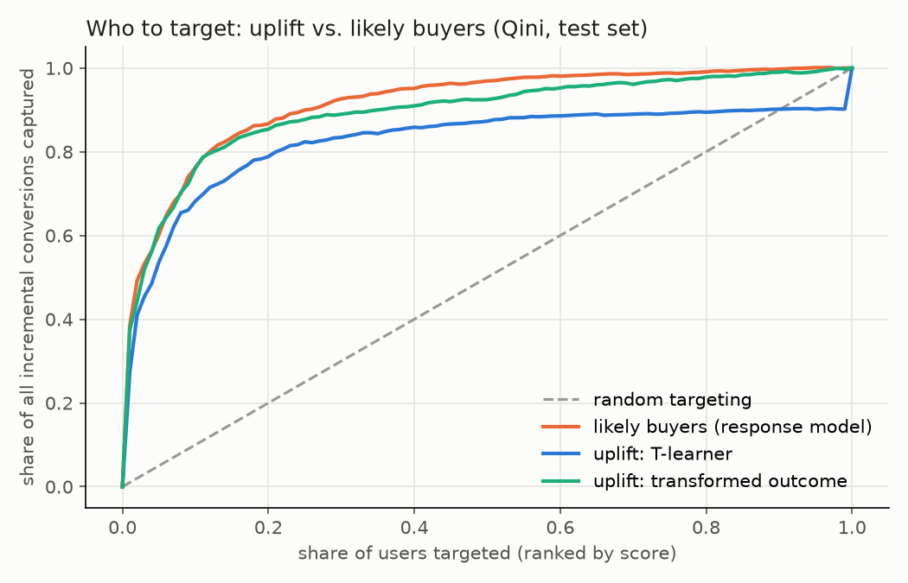

# Ad incrementality: Criteo Uplift (13,979,592 users)

## 1. Is the experiment trustworthy?
- Treated share 0.8500 vs. design 0.85: SRM p = 0.999
- Feature balance: largest |SMD| 0.0488, largest |z| 67.2; 12 of 12 features differ between arms at Bonferroni p < 0.05
- Predicting treatment from the 12 features: cross-fitted AUC 0.5082 (0.5 expected under clean randomization; null SE 0.0008)
- Exposure rate: treated 0.0360, control 0.0000

## 2. How much do ads lift outcomes? (intent-to-treat)

| outcome | treated | control | relative lift [95% CI] | absolute lift [95% CI] | p |
|---|---|---|---|---|---|
| visit | 0.04854 | 0.03820 | +27.1% [+26.2%, +28.0%] | +0.01034 [+0.01006, +0.01063] | 0 |
| conversion | 0.00309 | 0.00194 | +59.4% [+54.4%, +64.7%] | +0.00115 [+0.00108, +0.00122] | 3.2e-246 |

Effect on users actually shown an ad (ITT / exposure gap):

- visit: +0.28700 per exposed user [+0.27904, +0.29495]
- conversion: +0.03196 per exposed user [+0.03009, +0.03383]

## 3. Could the same answer come from a shorter test? (conversion)

| estimator | lift [95% CI] | CI width vs. raw | variance reduction | estimate shift vs. raw (raw SEs) | valid? |
|---|---|---|---|---|---|
| difference in means | +0.001152 [+0.001085, +0.001219] | - | - | - | - |
| CUPED, linear on 12 features | +0.000916 [+0.000852, +0.000980] | -5.5% | 10.7% | -6.9 | NO: estimate moved; covariates not balanced |
| CUPAC, cross-fitted GBM | +0.000905 [+0.000842, +0.000968] | -6.7% | 12.9% | -7.2 | NO: estimate moved; covariates not balanced |

Under valid randomization, adjustment narrows the CI without moving the estimate. A shift beyond 2 raw SEs means the features differ between arms, so the variance reduction cannot be claimed as a sample saving.

## 4. Who should be targeted? (conversion, held-out test set)

| strategy | Qini area above random [95% CI] | share of incremental, top 10% | share of incremental, top 20% | share of incremental, top 30% | share of incremental, top 50% |
|---|---|---|---|---|---|
| likely buyers (response model) | 0.412 [0.399, 0.425] | 76% [72, 80] | 87% [84, 89] | 93% [91, 95] | 97% [96, 98] |
| uplift: T-learner | 0.323 [0.284, 0.364] | 68% [63, 73] | 79% [75, 83] | 83% [79, 88] | 87% [83, 91] |
| uplift: transformed outcome | 0.391 [0.363, 0.418] | 76% [72, 81] | 85% [82, 89] | 89% [85, 93] | 92% [89, 96] |

Paired bootstrap difference vs. likely-buyer targeting (same resamples for every strategy):

- uplift: T-learner: Qini area -0.090 [-0.129, -0.039]; share captured top 10%: -8 pts [-13, -3], top 20%: -8 pts [-12, -4], top 30%: -9 pts [-14, -5], top 50%: -10 pts [-14, -5]
- uplift: transformed outcome: Qini area -0.022 [-0.050, -0.000]; share captured top 10%: -0 pts [-4, +3], top 20%: -1 pts [-5, +2], top 30%: -4 pts [-7, +0], top 50%: -4 pts [-7, -2]

## 5. Budget decision

Cost assumes $5.00 CPM and one impression per targeted user (an assumption, not data).

| strategy                       | target_top   |   incremental_conversions_per_1M_users |   cost_per_incremental_conversion_usd |
|:-------------------------------|:-------------|---------------------------------------:|--------------------------------------:|
| likely buyers (response model) | 10%          |                                  746.6 |                                  0.67 |
| likely buyers (response model) | 20%          |                                  848.5 |                                  1.18 |
| likely buyers (response model) | 30%          |                                  907   |                                  1.65 |
| likely buyers (response model) | 50%          |                                  948.8 |                                  2.63 |
| likely buyers (response model) | 100%         |                                  978.9 |                                  5.11 |
| uplift: T-learner              | 10%          |                                  668.1 |                                  0.75 |
| uplift: T-learner              | 20%          |                                  771.8 |                                  1.3  |
| uplift: T-learner              | 30%          |                                  816.7 |                                  1.84 |
| uplift: T-learner              | 50%          |                                  854.5 |                                  2.93 |
| uplift: T-learner              | 100%         |                                  978.9 |                                  5.11 |
| uplift: transformed outcome    | 10%          |                                  745.2 |                                  0.67 |
| uplift: transformed outcome    | 20%          |                                  835.9 |                                  1.2  |
| uplift: transformed outcome    | 30%          |                                  870.9 |                                  1.72 |
| uplift: transformed outcome    | 50%          |                                  905   |                                  2.76 |
| uplift: transformed outcome    | 100%         |                                  978.9 |                                  5.11 |
