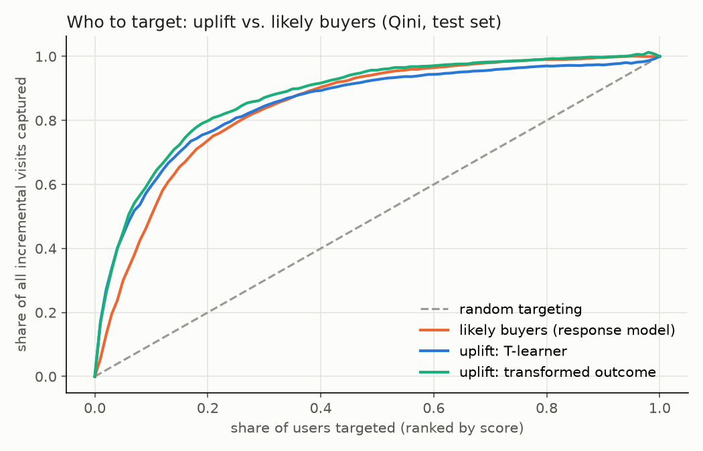

# Ad incrementality: Criteo Uplift (13,979,592 users)

## 1. Is the experiment trustworthy?
- Treated share 0.8500 vs. design 0.85: SRM p = 0.999
- Feature balance: largest |SMD| 0.0488, largest |z| 67.2; 12 of 12 features differ between arms at Bonferroni p < 0.05
- Predicting treatment from the 12 features: cross-fitted AUC 0.5082 (0.5 expected under clean randomization; null SE 0.0008)
- Exposure rate: treated 0.0360, control 0.0000

## 2. How much do ads lift outcomes? (intent-to-treat)

| outcome | treated | control | relative lift [95% CI] | absolute lift [95% CI] | p |
|---|---|---|---|---|---|
| visit | 0.04854 | 0.03820 | +27.1% [+26.2%, +28.0%] | +0.01034 [+0.01006, +0.01063] | 0 |
| conversion | 0.00309 | 0.00194 | +59.4% [+54.4%, +64.7%] | +0.00115 [+0.00108, +0.00122] | 3.2e-246 |

Effect on users actually shown an ad (ITT / exposure gap):

- visit: +0.28700 per exposed user [+0.27904, +0.29495]
- conversion: +0.03196 per exposed user [+0.03009, +0.03383]

## 3. Could the same answer come from a shorter test? (visit)

| estimator | lift [95% CI] | CI width vs. raw | variance reduction | estimate shift vs. raw (raw SEs) | valid? |
|---|---|---|---|---|---|
| difference in means | +0.010342 [+0.010056, +0.010629] | - | - | - | - |
| CUPED, linear on 12 features | +0.006980 [+0.006732, +0.007228] | -13.5% | 25.2% | -23.0 | NO: estimate moved; covariates not balanced |
| CUPAC, cross-fitted GBM | +0.006359 [+0.006120, +0.006597] | -16.8% | 30.7% | -27.2 | NO: estimate moved; covariates not balanced |

Under valid randomization, adjustment narrows the CI without moving the estimate. A shift beyond 2 raw SEs means the features differ between arms, so the variance reduction cannot be claimed as a sample saving.

## 4. Who should be targeted? (visit, held-out test set)

| strategy | Qini area above random [95% CI] | share of incremental, top 10% | share of incremental, top 20% | share of incremental, top 30% | share of incremental, top 50% |
|---|---|---|---|---|---|
| likely buyers (response model) | 0.341 [0.334, 0.350] | 50% [48, 53] | 74% [72, 76] | 84% [82, 85] | 95% [93, 96] |
| uplift: T-learner | 0.348 [0.331, 0.366] | 60% [57, 62] | 76% [74, 79] | 84% [82, 87] | 93% [91, 95] |
| uplift: transformed outcome | 0.373 [0.350, 0.394] | 62% [59, 65] | 80% [77, 83] | 87% [84, 90] | 96% [93, 98] |

Paired bootstrap difference vs. likely-buyer targeting (same resamples for every strategy):

- uplift: T-learner: Qini area +0.007 [-0.012, +0.025]; share captured top 10%: +9 pts [+6, +12], top 20%: +2 pts [-0, +5], top 30%: +1 pts [-1, +3], top 50%: -2 pts [-4, +0]
- uplift: transformed outcome: Qini area +0.031 [+0.006, +0.053]; share captured top 10%: +12 pts [+9, +15], top 20%: +6 pts [+3, +9], top 30%: +3 pts [+0, +6], top 50%: +1 pts [-2, +4]

## 5. Budget decision

Cost assumes $5.00 CPM and one impression per targeted user (an assumption, not data).

| strategy                       | target_top   |   incremental_visits_per_1M_users |   cost_per_incremental_visit_usd |
|:-------------------------------|:-------------|----------------------------------:|---------------------------------:|
| likely buyers (response model) | 10%          |                            4417.7 |                             0.11 |
| likely buyers (response model) | 20%          |                            6483.8 |                             0.15 |
| likely buyers (response model) | 30%          |                            7359.6 |                             0.2  |
| likely buyers (response model) | 50%          |                            8309.1 |                             0.3  |
| likely buyers (response model) | 100%         |                            8791.7 |                             0.57 |
| uplift: T-learner              | 10%          |                            5239.7 |                             0.1  |
| uplift: T-learner              | 20%          |                            6691.2 |                             0.15 |
| uplift: T-learner              | 30%          |                            7425.4 |                             0.2  |
| uplift: T-learner              | 50%          |                            8154.7 |                             0.31 |
| uplift: T-learner              | 100%         |                            8791.7 |                             0.57 |
| uplift: transformed outcome    | 10%          |                            5447.9 |                             0.09 |
| uplift: transformed outcome    | 20%          |                            7020.1 |                             0.14 |
| uplift: transformed outcome    | 30%          |                            7660.9 |                             0.2  |
| uplift: transformed outcome    | 50%          |                            8414.7 |                             0.3  |
| uplift: transformed outcome    | 100%         |                            8791.7 |                             0.57 |
